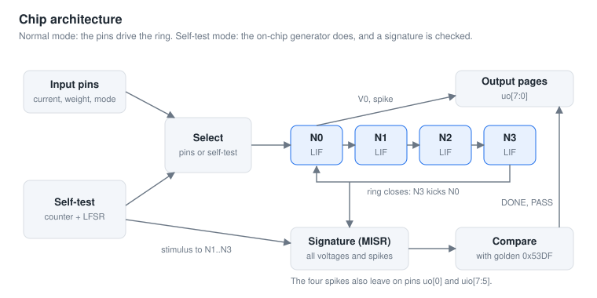
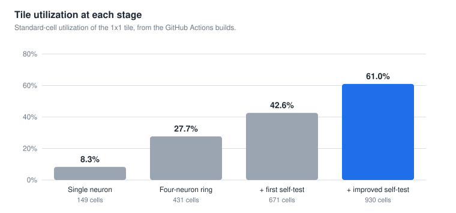
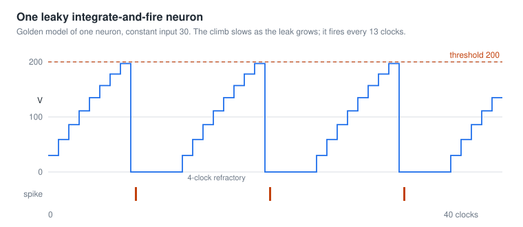
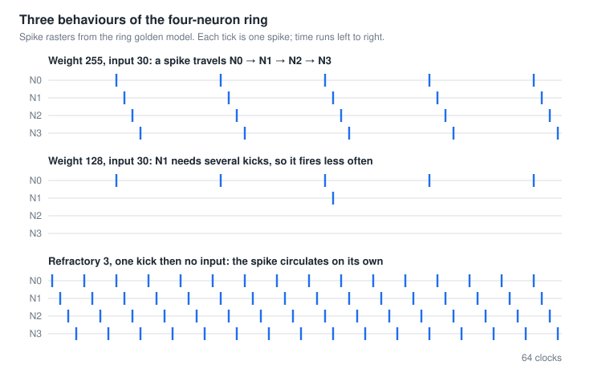
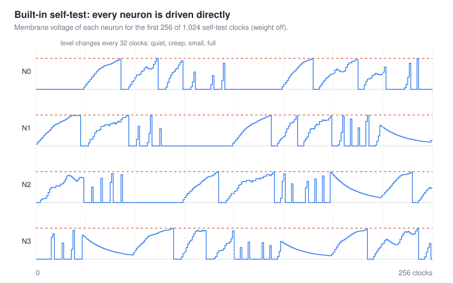
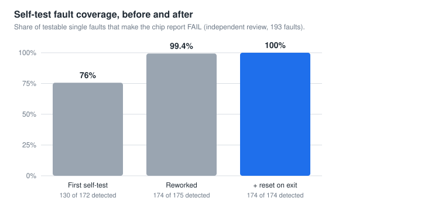

   

# LIF Spiking Pattern Generator

A small neuromorphic chip for the [Tiny Tapeout](https://tinytapeout.com) SKY 26D shuttle (SkyWater 130 nm):
four leaky integrate-and-fire (LIF) neurons wired in a ring, with a built-in self-test that checks the chip
at speed and reports pass or fail on one pin.

It started as a single neuron that used 8% of its tile. This README tells how it grew to 61%, what broke on
the way, and how each step was verified.

- **Top module:** `tt_um_justice_lif` (1x1 tile, 10 MHz target clock)
- **Source:** [`src/tt_um_justice_lif.v`](src/tt_um_justice_lif.v)
- **Datasheet and pin list:** [`docs/info.md`](docs/info.md)
- **Development log:** [`docs/devlog`](docs/devlog)
- **3D layout viewer:** [justicerebrovich.github.io/tt-lif-neuron](https://justicerebrovich.github.io/tt-lif-neuron/)



## The project in four stages

| Stage | What was added | Cells | Flip-flops | Utilization |
| --- | --- | --- | --- | --- |
| 1 | One LIF neuron | 149 | 12 | 8.3% |
| 2 | Four neurons in a ring, selectable weight and refractory mode | 431 | 48 | 27.7% |
| 3 | Built-in self-test (LFSR stimulus, MISR signature) | 671 | 83 | 42.6% |
| 4 | Self-test reworked for fault coverage | 930 | 83 | 61.0% |

Every row passed the RTL tests, the gate-level tests on the synthesized netlist, and all 15 Tiny Tapeout
prechecks in GitHub Actions.



The current layout, from the latest build:


## Stage 1: one neuron

A LIF neuron is the simplest useful model of a nerve cell. It behaves like a leaky bucket: input fills it, it
drains slowly, and when it overflows it fires a pulse and empties.

Each clock, the 8-bit membrane voltage `V` updates:

```
V_next = V - leak + I        leak = V >> 4, forced to at least 1 while V > 0
```

| Behavior | Implementation |
| --- | --- |
| Integrate | The input current is added to `V` each cycle |
| Leak | `V >> 4`, a shift, so no multiplier is needed |
| Clamp | The result is clamped to 0..255 instead of wrapping |
| Fire | A one-cycle spike when `V` reaches the threshold (200), then `V` resets to 0 |
| Refractory | Input is ignored for a few cycles after a spike |



The design is checked cycle by cycle against a Python golden model with [cocotb](https://www.cocotb.org).
That found the first bug before any hardware existed: `V >> 4` is 0 once `V` drops below 16, so the neuron got
stuck at 15 instead of decaying to rest. The fix is the "at least 1" in the leak.

This version hardened to 149 cells and used 8.3% of the tile. Since a tile costs the same however full it is,
the next question was what to do with the other 92%.

## Stage 2: a ring of four

Four copies of the neuron are wired in a ring. Neuron 0 is driven by the input pins. Every spike "kicks" the
next neuron, and the last one kicks the first. Two controls shape the pattern:

- **Weight** (`uio[1:0]`: 0, 64, 128 or 255) is how hard one spike kicks the next neuron. It is the digital
  version of a synapse's strength.
- **Refractory mode** (`uio[2]`) selects a 4-cycle or 3-cycle recovery after a spike.



The third behaviour came out of a review finding. An independent verifier showed that with a 4-cycle
refractory period the kick from neuron 3 always reached neuron 0 while it was still recovering, so the link
that closes the ring was dead logic. A 3-cycle mode lets the kick land just after neuron 0 recovers, and one
spike then circulates with no further input. This is the principle behind the rhythm-generating circuits
animals use for walking and swimming.

## Stage 3: built-in self-test

Setting one pin (`uio[3]`) makes the chip test itself:

1. The neurons are reset.
2. An on-chip pseudo-random generator (an 8-bit LFSR) drives the ring for 1,024 clocks, while a counter steps
   through every weight and both refractory modes.
3. A 16-bit signature register (MISR) compresses the response into one number.
4. `uo[0]` reports DONE and `uo[1]` reports PASS if the signature equals the value the Python golden model
   predicts (`0x53DF`).

A self-test is only worth something if it can fail, so the test suite builds the design 17 more times with
one deliberate change each (a wrong threshold, and each of the 16 signature bits flipped in the expected
value). The self-test must report FAIL on every one.

## Stage 4: measuring the self-test, and fixing it

The first self-test passed all of its tests, and it was still not good enough. An independent review injected
193 single faults into the design and ran the self-test on each one. It caught 130. Of the rest, 41 were real
defects that would still have read PASS.

The cause was that only neuron 0 was driven by the generator, and the signature saw only the spikes and four
bits of one voltage. Neurons 1 to 3 fired almost only from a single full-strength kick, so their voltage
registers, leak and thresholds were barely exercised.

The fix was to drive every neuron directly, at four amplitude levels that rotate every 32 clocks, and to feed
every voltage bit into the signature:



The "creep" level keeps a voltage hovering just under the threshold, which is what catches a threshold that
is off by one.



| Self-test | Faults detected, of 193 | Real faults that still read PASS | Coverage of testable faults |
| --- | --- | --- | --- |
| First version: only neuron 0 driven | 130 | 41 | 76% |
| Reworked: every neuron driven and observed | 174 | 1 | 99.4% |

The faults that remain undetected are in logic no stimulus can reach from the pins. The one real hole needed
the ring to keep its self-test state afterwards, so the neurons are now reset when the self-test is switched
off. That last change has not been re-measured by the reviewer.
[`test/bist_faultsim.py`](test/bist_faultsim.py) is the small fault simulator used to tune the stimulus.

Better coverage was not free: the extra stimulus logic took the design from 42.6% to 61.0% of the tile.

## Pinout

| Pins | Function |
| --- | --- |
| `ui[7:0]` | Input current `I` to neuron 0 |
| `uo[0]` | Neuron 0 spike (self-test: DONE) |
| `uo[7:1]` | Neuron 0 membrane voltage `V[7:1]` (self-test: PASS on `uo[1]`, signature bits on `uo[7:2]`) |
| `uio[1:0]` | Input: ring weight select |
| `uio[2]` | Input: refractory mode (0 = 4 cycles, 1 = 3 cycles) |
| `uio[3]` | Input: run the built-in self-test |
| `uio[4]` | Input: with the self-test on, show the signature high byte on `uo`. With it off, `uo` reads 0 |
| `uio[7:5]` | Output: spikes of neurons 3, 2, 1 |

## Verification

Three Python golden models predict the design's behaviour, and cocotb compares the RTL with them on every clock:

| Model | Covers | Tests |
| --- | --- | --- |
| [`test/lif_model.py`](test/lif_model.py) | One neuron | [`test_lif.py`](test/test_lif.py), 6 tests |
| [`test/ring_model.py`](test/ring_model.py) | The four-neuron ring | [`test_ring.py`](test/test_ring.py), 8 tests |
| [`test/chip_model.py`](test/chip_model.py) | Every pin of the chip, including the self-test | [`test_bist.py`](test/test_bist.py), 6 tests |

The same tests run on the gate-level netlist after synthesis. Only the pins are visible there, so internal
voltages are checked in RTL simulation only.

To run everything locally, including the 17 altered builds:

```bash
cd test
python run.py
```

The last line should read `SUMMARY: normal build 20/20 tests passed; self-test reported FAIL on 17/17 altered builds`.
The Tiny Tapeout template flow (`make -B` in `test/`) runs the three test files.

### What went wrong along the way

| Problem | How it was found | Fix |
| --- | --- | --- |
| Neuron stuck at `V = 15` | `test_decay_to_rest` in simulation | Leak is at least 1 while `V > 0` |
| Gate-level tests could not read the internal `V` | First gate-level run in CI | Read `V` from the output pins when the internal signal does not exist |
| Gate-level tests read outputs too early | Second gate-level run in CI | Sample 2 ns after the clock edge, once gate delays settle |
| Ring-closing link was dead logic | Independent review | 3-cycle refractory mode |
| `uio_oe` never checked: a mutant with the spike pins disabled passed every test | Mutation testing in the review | Check every output pin on every clock |
| Self-test missed 41 real faults | Fault injection in the review | Drive and observe every neuron |
| PASS comparator checked on only two bits | Mutation testing in the review | One altered build per signature bit |

## Implementation results

From the GitHub Actions build (`gds` workflow) of the current design:

| Metric | Value |
| --- | --- |
| Standard cells, excluding fill and tap | 930 |
| Flip-flops | 83 |
| Utilization of the 1x1 tile | 61.0% |
| Routed wire length | 21,874 µm |
| Tiny Tapeout prechecks | 15 of 15 passed |
| Gate-level simulation | Passes |

Timing was read from the build one commit earlier, which is the same design apart from the reset on self-test
exit. The flow constrains the clock to 20 ns; the design targets 100 ns.

| Check | Typical corner | Slowest corner |
| --- | --- | --- |
| Setup, worst slack | 7.97 ns | 0.02 ns (9.6 ns register to register) |
| Hold, worst slack | 0.32 ns | 0.91 ns |

There are no setup or hold violations in any corner. There is one open warning: at the slowest corner
(slow transistors, 100 °C, 1.60 V) 194 pins on high-fanout self-test nets have slower edges than the library
limit. Details are in [`docs/devlog/2026-11-16-timing-and-slew.md`](docs/devlog/2026-11-16-timing-and-slew.md).

Not yet done: the fabricated chip has not been tested, because it has not been manufactured.

## Repository layout

```
src/        Verilog source and LibreLane config
test/       cocotb tests, golden models, fault simulator
docs/       Datasheet (info.md) and development log (devlog/)
images/     README figures and the script that generates them from the golden models
info.yaml   Tiny Tapeout project metadata and pinout
```

The figures are generated, not drawn: `python images/make_figures.py` rebuilds them from the same models the
tests use.

## About

Written by Justice Rebrovich (University of North Dakota, B.S. Electrical Engineering) as a hands-on
project in digital IC design, design verification and design for test. Built from the
[Tiny Tapeout Verilog template](https://github.com/TinyTapeout/ttsky-verilog-template). Licensed under Apache-2.0.
